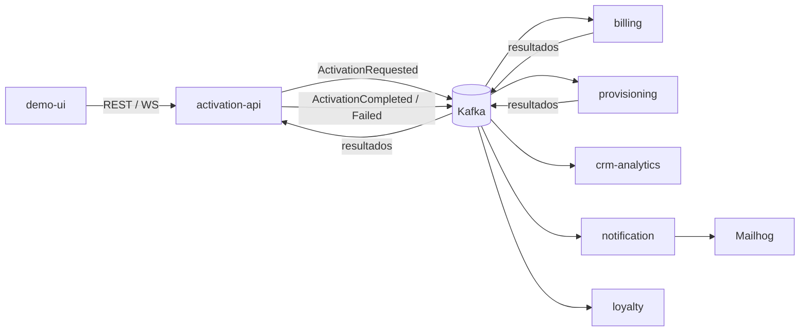

# POC Activación de Servicios con Kafka

TP6 · Sistemas Distribuidos 2026 · Ingeniería en Sistemas de Información.

Prueba de concepto que muestra que la activación de un plan se puede resolver publicando **un único evento** en
Kafka, **sin que ningún servicio llame directamente a otro**. Un cliente contrata un plan desde una UI en React;
eso dispara facturación, aprovisionamiento, notificación por email y registro en CRM, coordinados por eventos
(coreografía con agregador). Todo corre en local con Docker Compose y los sistemas externos se simulan.

| Documento | Contenido |
|---|---|
| [`docs/consigna.pdf`](docs/consigna.pdf) | Enunciado y documento de arquitectura original (**fuente de verdad**) |
| [`docs/architecture.md`](docs/architecture.md) | Arquitectura implementada, diagramas, contratos, modelo de datos, decisiones, **desvíos** y riesgos abiertos |
| [`docs/demo-script.md`](docs/demo-script.md) | Guion de la demo de 15 minutos (5 escenarios + idempotencia y DLQ) |
| [`CLAUDE.md`](CLAUDE.md) | Resumen operativo del proyecto y registro de decisiones de implementación (D-01 … D-33) |

## Qué hay adentro



- **Kafka** 3.9.2 en modo KRaft (1 broker), 4 topics de negocio + 4 DLQ, 3 particiones cada uno, clave =
  `customerId`.
- **6 apps NestJS** (`activation-api`, `billing-service`, `provisioning-service`, `notification-service`,
  `crm-analytics-service`, `loyalty-service`) con el transporte Kafka de `@nestjs/microservices` (kafkajs).
- **demo-ui** en React + Vite + socket.io-client (timeline en vivo).
- **MongoDB** 7.0 en replica set de 1 nodo, una base por servicio.
- **Kafka UI** (kafbat) y **Mailhog**.
- Idempotencia (`processed_events`), reintentos 1/2/4 s, DLQ, commit manual de offsets, compensación.

## Requisitos

| Requisito | Versión usada | Notas |
|---|---|---|
| Docker Engine | 29 | |
| Docker Compose | v2.20+ (probado con v5) | Se usan `start_interval` en healthchecks y `profiles` |
| RAM libre | ≈ 1,5 GB | Todo levantado consume ≈ 1,2 GB (ver [Troubleshooting](#troubleshooting)) |
| Puertos libres | 3000, 5173, 8025, 8080, 9092, 27017, 1025 (solo 127.0.0.1) | |
| Node.js + pnpm | Node 22, pnpm 12 | **Solo** para correr los tests o las apps fuera de Docker |

Para levantar la demo **no hace falta** tener Node ni pnpm: todo se compila dentro de Docker.

## Levantar todo

```bash
docker compose up -d --build
```

La primera vez tarda unos minutos (build de las imágenes). Después, ≈ 1 minuto hasta que todo está listo. No hay
pasos manuales: `kafka-init` crea los topics y el healthcheck de Mongo inicializa el replica set.

Comprobar que arrancó:

```bash
docker compose ps        # kafka, mongo y activation-api (healthy); el resto Up; kafka-init ya terminó
curl -s localhost:3000/health
```

Probar una activación por CLI:

```bash
curl -s -X POST localhost:3000/activations -H 'content-type: application/json' \
  -d '{"customerId":"C-1234","planId":"Plan Digital","simulateFailure":"none"}'
# → 202 {"activationId":"act-…","status":"PENDING"}

curl -s localhost:3000/activations/act-…   # a los 1–3 s: "status":"ACTIVE" + historial de 4 eventos
```

`simulateFailure` acepta `none`, `billing` o `provisioning`.

Apagar:

```bash
docker compose --profile loyalty down      # conserva los datos
docker compose --profile loyalty down -v   # borra topics, offsets y bases (estado limpio)
```

## URLs y puertos

| Servicio | URL / puerto | Para qué |
|---|---|---|
| **Demo UI** | <http://localhost:5173> | Contratar un plan y ver la timeline en vivo |
| **activation-api** | <http://localhost:3000> | REST + WebSocket (socket.io, mensaje `activation.updated`) |
| **Kafka UI** | <http://localhost:8080> | Topics, mensajes, particiones, consumer groups y lag (cluster `activation-poc`) |
| **Mailhog** | <http://localhost:8025> | Bandeja de los emails (API en `/api/v2/messages`) |
| Kafka | `localhost:9092` | Listener externo para apps en el host (interno: `kafka:19092`) |
| MongoDB | `localhost:27017` | `mongodb://localhost:27017/<base>?replicaSet=rs0&directConnection=true` |
| SMTP Mailhog | `127.0.0.1:1025` | Solo para correr notification-service en el host |

### API REST

| Método y ruta | Respuesta |
|---|---|
| `POST /activations` | `202 Accepted` `{ activationId, status: "PENDING" }`. Body: `customerId`, `planId`, `simulateFailure?`, `channel?` |
| `GET /activations/:id` | Estado, `steps` (resultado de billing y provisioning) e `history` (todos los eventos) |
| `GET /activations?limit=20` | Activaciones recientes, la más nueva primero (lo usa la UI) |
| `GET /health` | `{"status":"ok"}` (healthcheck de Compose) |

## Estructura del repo

```
activation-poc/
├── apps/
│   ├── activation-api/          REST + WebSocket + agregador de la saga (tests de la saga)
│   ├── billing-service/         cuenta de facturación + compensación
│   ├── provisioning-service/    aprovisionamiento simulado (1–3 s)
│   ├── notification-service/    emails a Mailhog
│   ├── crm-analytics-service/   event_log de todos los eventos (no publica)
│   ├── loyalty-service/         escenario 5 (profile "loyalty")
│   └── demo-ui/                 React + Vite + socket.io-client (servida con nginx)
├── libs/
│   ├── contracts/               @poc/contracts: sobre común, eventos versionados, topics, validación
│   └── kafka-toolkit/           @poc/kafka-toolkit: publicador, EventConsumer (idempotencia, reintentos, DLQ, commit)
├── docker/
│   └── create-topics.sh         crea los 4 topics + 4 DLQ (3 particiones, retención 7 días)
├── scripts/                     apoyo para la demo (ver abajo)
├── Dockerfile                   imagen única para las apps Nest (ARG APP)
├── docker-compose.yml           versiones de imágenes fijadas, mem_limit en cada contenedor
├── pnpm-workspace.yaml
└── docs/
    ├── consigna.pdf
    ├── architecture.md
    └── demo-script.md
```

## Tests

Los tests unitarios cubren la regla de agregación de la saga (`decide()`) y la traducción de eventos al
historial, en `apps/activation-api`.

```bash
pnpm install
pnpm test
# Test Suites: 2 passed · Tests: 10 passed
```

El resto del comportamiento (idempotencia, DLQ, compensación, escalado, replay) se verifica de punta a punta con
el stack levantado, con los scripts de abajo y el [guion de la demo](docs/demo-script.md).

## Scripts

Todos se corren desde la raíz con el stack levantado; usan las herramientas de Kafka **dentro** del contenedor
`kafka` (no hace falta instalar nada en el host salvo `python3` para `replay-event.sh`).

| Script | Qué hace |
|---|---|
| `scripts/consumer-groups.sh [group]` | Lo mismo que Kafka UI → Consumers: partición, offset, lag y host de cada group (o de uno). |
| `scripts/replay-event.sh [-t topic] [eventId]` | Reenvía un evento **ya procesado** (mismo value, key y headers). Sin argumentos toma el último de `activation.requested`. Demuestra la idempotencia. |
| `scripts/send-invalid-message.sh [json\|contract]` | Publica un mensaje inválido en `activation.requested` (JSON roto o contrato incumplido) y muestra lo que llegó a `activation.requested.dlq`. |
| `scripts/crm-reprocess.sh` | RF-10: borra el `event_log` de crm-analytics, rebobina su consumer group al inicio y lo reinicia: reconstruye todo desde Kafka. |

Comandos de los escenarios del guion:

```bash
docker compose stop notification-service && docker compose start notification-service   # escenario 3
docker compose up -d --scale billing-service=2                                           # escenario 4
docker compose --profile loyalty up -d loyalty-service                                   # escenario 5
```

## Desarrollo (apps en el host)

```bash
pnpm install
pnpm dev:infra                # kafka, kafka-init, kafka-ui, mongo, mailhog en Docker
pnpm dev:api                  # y en otras terminales: dev:billing, dev:provisioning,
                              # dev:notification, dev:crm, dev:loyalty, dev:ui
```

Variables comunes: `KAFKA_BROKERS` (default `localhost:9092`), `KAFKA_CLIENT_ID`, `KAFKA_GROUP_ID`, `MONGO_URI`
(ver `.env.example`; desde el host agregar `?replicaSet=rs0&directConnection=true`). Si se corre una app en el
host, detener su contenedor antes (`docker compose stop billing-service`) para no tener dos instancias en el
mismo group.

## Troubleshooting

| Síntoma | Causa | Solución |
|---|---|---|
| `mongo` se reinicia o sale con *"cannot start"* / error de tcmalloc o rseq | **MongoDB 8.x no arranca en kernels Linux ≥ 6.19** (SERVER-121912). | El compose ya usa **`mongo:7.0.45`**, que tiene replica set y transacciones. No subir a 8.x en estas máquinas. Ver la versión del kernel con `uname -r`. |
| Las apps salen con error al conectar a Kafka y reinician | Kafka tarda en arrancar (JVM + KRaft). | Es esperable en el primer arranque: las apps esperan a que `kafka-init` termine (que a su vez espera el healthcheck de Kafka) y tienen `restart: on-failure`. Esperar ≈ 1 min y revisar `docker compose ps`. Si `kafka-init` no terminó: `docker compose logs kafka kafka-init`. |
| En los logs aparece una vez `The group coordinator is not available` | Kafka todavía está creando `__consumer_offsets`. | No es un error; kafkajs reintenta solo. |
| `mongo` queda en `starting`/`unhealthy` | El replica set todavía no tiene PRIMARY. | El healthcheck lo inicializa solo; esperar. Si persiste: `docker compose logs mongo`. Con datos de una versión anterior de Mongo: `docker compose down -v`. |
| La máquina se queda sin memoria / contenedores con `OOMKilled` | RAM. | Cada contenedor tiene `mem_limit` (Kafka 1 GB con heap 512 MB, Kafka UI 512 MB, Mongo 700 MB con caché de 0,25 GB, apps Nest 200 MB). Con todo levantado se usan ≈ 1,2 GB (`docker stats`). Cerrar otros programas; si hace falta, no levantar `kafka-ui` durante pruebas por CLI (`docker compose stop kafka-ui`). |
| Kafka UI no muestra el cluster | Arranca después de Kafka y tarda unos segundos más. | Recargar; si no, `docker compose restart kafka-ui`. |
| La Demo UI dice "Sin conexión" | activation-api no está healthy o se reinició. | `docker compose ps activation-api`; recargar la página. |
| No llegan emails | notification-service caído o Mailhog detenido. | `docker compose ps notification-service mailhog`, `scripts/consumer-groups.sh notification-svc`. Si Mailhog estuvo caído más de 7 s, ese email quedó en `activation.events.dlq`. |
| Puerto ocupado | Otro proceso usa 3000/5173/8080/8025/9092/27017. | Liberar el puerto o cambiar el mapeo en `docker-compose.yml`. |
| Estado raro después de muchas pruebas | Datos de ensayos anteriores. | `docker compose --profile loyalty down -v && docker compose up -d --build`. |

## Criterios de aceptación

Criterios de `docs/consigna.pdf` §11. Verificados con `docker compose up -d --build` desde cero (volúmenes
borrados), al cerrar la fase 3.

| | Criterio | Estado | Evidencia |
|---|---|---|---|
| ✅ | `docker compose up` levanta todo sin pasos manuales. | **Verificado** | Desde `down -v`: `kafka-init` crea los 8 topics con 3 particiones y retención 7 días (`docker compose logs kafka-init`), el healthcheck de Mongo inicializa `rs0`, las apps esperan con `depends_on: condition` y `demo-ui` arranca cuando `activation-api` está healthy. Ningún comando adicional. |
| 🟡 | Los 5 escenarios del guion se ejecutan de punta a punta en menos de 15 minutos. | **Parcial** | Los 5 escenarios se ejecutaron completos por CLI, cada uno en menos de 1 minuto: esc. 1 y 2 (REST, WebSocket, UI en el navegador y API de Mailhog); esc. 3 (Kafka UI: `notification-svc` `state=EMPTY, consumerLag=3`, al volver 3 emails y lag 0); esc. 4 (`billing-svc` STABLE con 2 miembros, particiones 2+1 por topic, 7 activaciones repartidas 3 y 4, 0 cuentas duplicadas); esc. 5 (loyalty procesa los 12 eventos de `activation.events` sin tocar otros groups). **Falta un ensayo cronometrado completo con la UI** siguiendo [`docs/demo-script.md`](docs/demo-script.md). |
| ✅ | Reenviar un evento ya procesado no genera cuentas ni emails duplicados. | **Verificado** | `scripts/replay-event.sh` con `ActivationRequested`, `ActivationFailed`, `ActivationCompleted` y `BillingAccountCreated` ya procesados: cada consumidor loguea "ya procesado (processed_events)" y no cambian `billing_accounts`, `provisioning_orders`, `notifications`, los emails de Mailhog, `event_log`, el historial de la activación ni los puntos de loyalty. También se probaron dos entregas **concurrentes** del mismo `eventId`: el efecto se aplica una sola vez. |
| ✅ | Un mensaje inválido termina en la DLQ y el resto del flujo sigue. | **Verificado** | `scripts/send-invalid-message.sh` y `... contract`: 3 copias en `activation.requested.dlq` (billing, provisioning, crm-analytics) con `dlq-reason=INVALID_MESSAGE` y el resto de los headers; la activación siguiente termina `ACTIVE` y el lag queda en 0. Error técnico: con Mailhog detenido, notification hace 4 intentos (esperas 1/2/4 s) y manda el original a `activation.events.dlq` con `dlq-reason=PROCESSING_ERROR`; con Mailhog de vuelta, el flujo sigue. |
| ✅ | Todos los eventos de una activación se pueden rastrear por `correlationId`. | **Verificado** | Todo evento lleva `correlationId` = `activationId` en el sobre y en los headers de Kafka (filtrable en Kafka UI). `GET /activations/:id` devuelve el historial completo; `event_log` de crm-analytics tiene índice por `correlationId` (`db.event_log.find({correlationId: "act-…"})` en la base `crm`); todos los logs empiezan con `[act-…] <eventType>`. |

Requerimientos funcionales y no funcionales (RF-01 a RF-10, RNF-01 a RNF-07): todos cubiertos; el detalle de cómo
se implementó cada uno y las desviaciones está en [`docs/architecture.md`](docs/architecture.md).

## Fuera de alcance y pendientes

- Según el documento: integración con sistemas reales, autenticación, alta disponibilidad, pruebas de carga.
- **Fase 4 (opcional, no implementada):** outbox transaccional, Schema Registry, OpenTelemetry. Mientras no exista
  el outbox, un evento se puede perder si un servicio se cae entre guardar y publicar; y notification puede
  reenviar un email si se cae entre el envío y el commit. Detalle en
  [Riesgos abiertos](docs/architecture.md#10-riesgos-abiertos).
- Grabar el video de respaldo de los 5 escenarios (mitigación de riesgo del documento).
