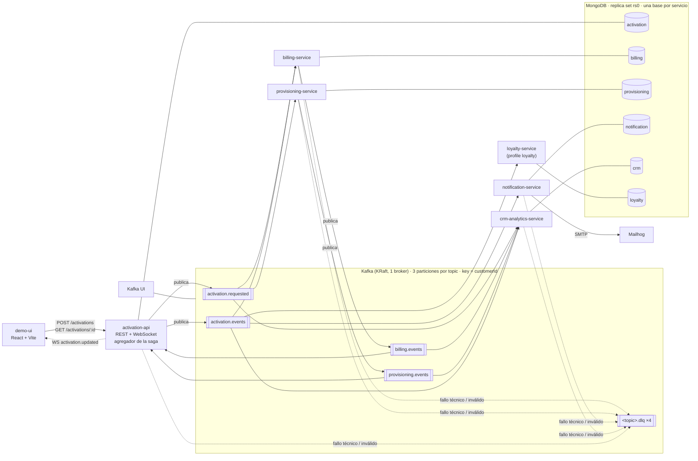
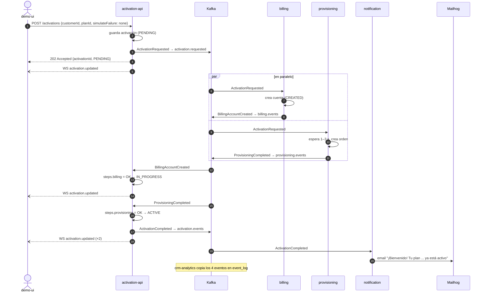
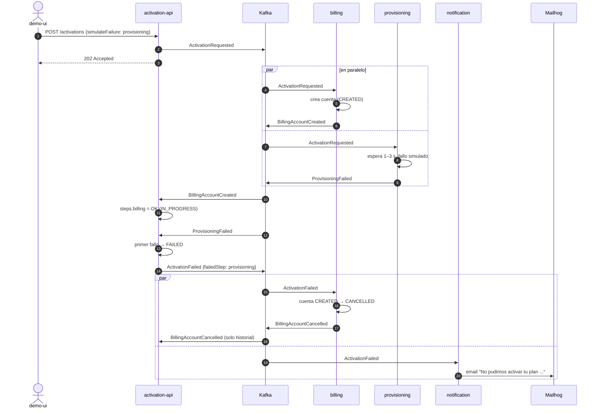
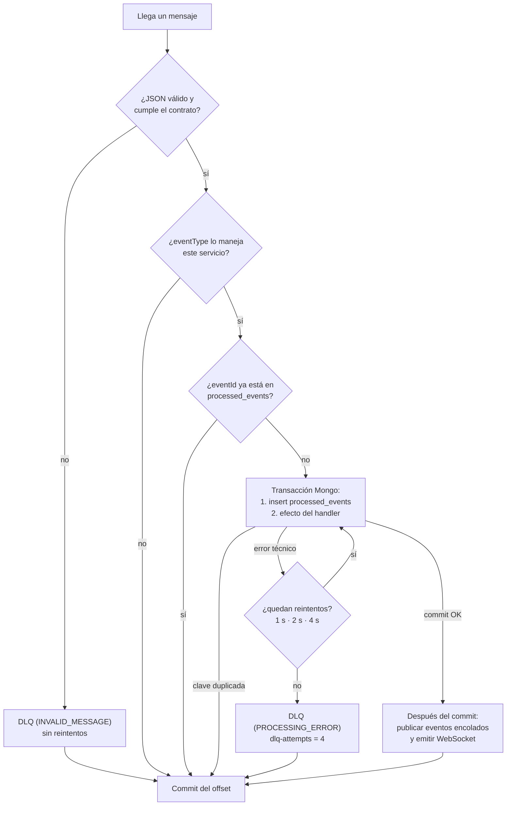
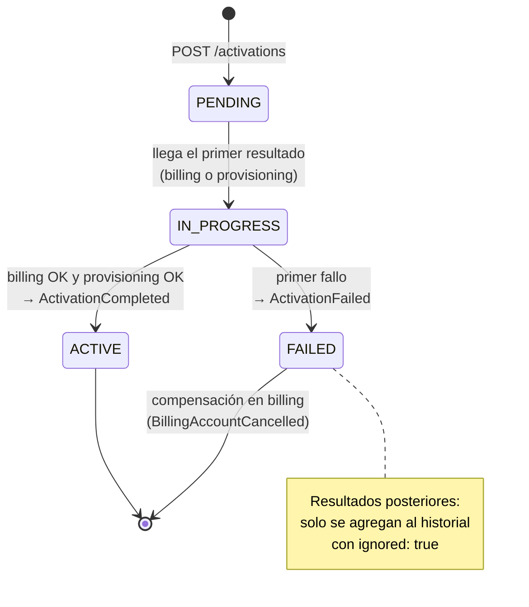

# Arquitectura — POC Activación de Servicios con Kafka

> TP6 · Sistemas Distribuidos 2026. Este documento describe la arquitectura **tal como quedó implementada**
> al cerrar la fase 3. La fuente de verdad del diseño es [`docs/consigna.pdf`](consigna.pdf); cuando la
> implementación se aparta de ella, se explica en [Desvíos respecto del documento original](#9-desvíos-respecto-del-documento-original).
> Los códigos `D-xx` remiten al registro de decisiones de `CLAUDE.md` (§14).

## Índice

1. [Resumen](#1-resumen)
2. [Componentes](#2-componentes)
3. [Topics y contratos de eventos](#3-topics-y-contratos-de-eventos)
4. [Flujos](#4-flujos)
5. [Estados de la saga](#5-estados-de-la-saga)
6. [Modelo de datos](#6-modelo-de-datos-mongodb)
7. [Decisiones técnicas](#7-decisiones-técnicas)
8. [Infraestructura y entorno](#8-infraestructura-y-entorno)
9. [Desvíos respecto del documento original](#9-desvíos-respecto-del-documento-original)
10. [Riesgos abiertos](#10-riesgos-abiertos)
11. [Estado por fase](#11-estado-por-fase)

---

## 1. Resumen

La activación de un plan se resuelve publicando **un único evento** (`ActivationRequested`) en Kafka.
Ningún servicio llama a otro: no hay HTTP entre servicios ni lectura de bases ajenas.

- **Coreografía con agregador.** billing y provisioning reaccionan solos a `ActivationRequested`, en paralelo.
  `activation-api` no da órdenes: solo junta los dos resultados y decide `ActivationCompleted` o `ActivationFailed`.
- **Un único punto de entrada.** `activation-api` expone REST y WebSocket; todo lo demás reacciona a eventos.
- **Confiabilidad.** Cada consumidor es idempotente (`processed_events` en la misma transacción que su efecto),
  reintenta los errores técnicos (1 s, 2 s, 4 s), manda a la DLQ lo que no puede procesar y confirma el offset
  recién después de procesar.
- **Todo local.** Docker Compose levanta Kafka (KRaft, 1 broker), MongoDB (replica set de 1 nodo), Kafka UI,
  Mailhog, las 6 apps NestJS y la UI. Los sistemas externos se simulan.

## 2. Componentes



| Componente | Responsabilidad | Consume (group) | Publica |
|---|---|---|---|
| **demo-ui** | Formulario "Contratar plan" (cliente, plan, fallo forzado: ninguno / billing / provisioning), lista de recientes y timeline en vivo por WebSocket. Build estático servido con nginx. | — | — |
| **activation-api** | `POST /activations` (202 `PENDING`), `GET /activations/:id`, `GET /activations`, `GET /health`. Guarda la activación, publica `ActivationRequested`, agrega resultados y publica el resultado final. `@WebSocketGateway` (socket.io, puerto 3000) emite cada cambio. | `billing.events`, `provisioning.events` (`activation-api`) | `activation.requested`, `activation.events` |
| **billing-service** | Crea la cuenta de facturación simulada; la anula ante `ActivationFailed` (compensación), incluso si la crea después de haber visto el fallo. | `activation.requested`, `activation.events` (`billing-svc`) | `billing.events` |
| **provisioning-service** | Simula el aprovisionamiento con un retardo aleatorio de 1 a 3 s. Falla a pedido. | `activation.requested` (`provisioning-svc`) | `provisioning.events` |
| **notification-service** | Email de bienvenida (`ActivationCompleted`) o de error (`ActivationFailed`) por SMTP a Mailhog. | `activation.events` (`notification-svc`) | — |
| **crm-analytics-service** | Guarda una copia de cada evento en `event_log`. No publica nada. Puede reprocesar el historial desde el inicio. | los 4 topics de negocio (`crm-analytics`) | — |
| **loyalty-service** | Escenario 5: consumidor nuevo que lee `activation.events` desde el inicio y suma 100 puntos por activación completada. | `activation.events` (`loyalty-svc`) | — |
| **MongoDB** | Una base por servicio: estado, `processed_events` y colecciones propias. Replica set de 1 nodo (transacciones). | — | — |
| **Kafka UI** (kafbat) | Topics, mensajes, particiones, consumer groups y lag en vivo. | — | — |
| **Mailhog** | Bandeja de entrada web para ver los emails. | — | — |

Además de lo que figura en la tabla, **todo consumidor** puede publicar en la DLQ del topic que estaba
leyendo (`<topic>.dlq`).

### Librerías compartidas

| Paquete | Contenido |
|---|---|
| `@poc/contracts` (`libs/contracts`) | Única fuente de verdad de los eventos: sobre común (`EventEnvelope`), payload y **versión** de cada `eventType` (`EVENT_VERSIONS`), nombres de topics y consumer groups, `createEvent()` (completa `eventId`, `version`, `occurredAt`) y `validateEvent()` (valida el contrato de lo que llega por cada topic). Nombres de headers, incluidos los de la DLQ. |
| `@poc/kafka-toolkit` (`libs/kafka-toolkit`) | Aísla el cliente Kafka (kafkajs vía `@nestjs/microservices`): opciones de servidor/productor, `EventPublisher` (key = `customerId`, headers `eventType`/`correlationId`/`eventId`), `EventConsumer.process()` (contrato + idempotencia + reintentos + DLQ + commit manual), `DlqPublisher`, `withRetries()` e `initGroupOffsets()`. |

Ningún servicio importa código de otro; solo estas dos librerías.

## 3. Topics y contratos de eventos

Los crea `docker/create-topics.sh` (contenedor `kafka-init`); el broker tiene `auto.create.topics.enable=false`.
**Todos: 3 particiones, factor de replicación 1, `retention.ms=604800000` (7 días), clave del mensaje = `customerId`.**

| Topic | Eventos | Productor | Consumer groups |
|---|---|---|---|
| `activation.requested` | `ActivationRequested` | activation-api | `billing-svc`, `provisioning-svc`, `crm-analytics` |
| `billing.events` | `BillingAccountCreated`, `BillingFailed`, `BillingAccountCancelled` | billing | `activation-api`, `crm-analytics` |
| `provisioning.events` | `ProvisioningCompleted`, `ProvisioningFailed` | provisioning | `activation-api`, `crm-analytics` |
| `activation.events` | `ActivationCompleted`, `ActivationFailed` | activation-api | `notification-svc`, `billing-svc`, `crm-analytics`, `loyalty-svc` |
| `activation.requested.dlq`, `billing.events.dlq`, `provisioning.events.dlq`, `activation.events.dlq` | el mensaje original que no se pudo procesar | el consumidor que falló | inspección manual en Kafka UI |

### Sobre común

```json
{
  "eventId": "7c9e6679-7425-40de-944b-e07fc1f90ae7",
  "eventType": "ActivationRequested",
  "version": 1,
  "occurredAt": "2026-09-27T16:40:00Z",
  "correlationId": "act-0001",
  "customerId": "C-1234",
  "source": "activation-api",
  "payload": { "planId": "Plan Digital", "channel": "web", "simulateFailure": "none" }
}
```

| Campo | Uso |
|---|---|
| `eventId` | UUID; base de la idempotencia (`processed_events`). |
| `eventType` + `version` | Evolución del contrato. Hoy todos los eventos están en `version: 1`. |
| `occurredAt` | ISO-8601 UTC; es el `at` del historial. |
| `correlationId` | El `activationId`; agrupa todos los eventos de una activación (RNF-06). |
| `customerId` | También es la **clave** del mensaje: mismo cliente → misma partición → orden garantizado (RNF-02). |
| `source` | `activation-api`, `billing-service` o `provisioning-service`. |

Cada mensaje lleva además los headers `eventType`, `correlationId` y `eventId`, para filtrar en Kafka UI sin
abrir el JSON.

### Payloads (versión 1)

| Evento | Payload |
|---|---|
| `ActivationRequested` | `planId`, `channel`, `simulateFailure` (`none` \| `billing` \| `provisioning`) |
| `BillingAccountCreated` | `accountId`, `planId` |
| `BillingFailed` | `reason` |
| `BillingAccountCancelled` | `accountId`, `reason` |
| `ProvisioningCompleted` | `orderId`, `planId` |
| `ProvisioningFailed` | `reason` |
| `ActivationCompleted` | `planId` |
| `ActivationFailed` | `planId`, `failedStep` (`billing` \| `provisioning`), `reason` |

### Validación del contrato

`validateEvent(topic, value)` (en `@poc/contracts`) exige: sobre completo (strings no vacíos), `eventType`
permitido **en ese topic**, `version` igual a la vigente, `occurredAt` parseable y los campos obligatorios del
payload. Los campos extra se aceptan (son cambios compatibles). Un mensaje que no cumple va a la DLQ con
`dlq-reason: INVALID_MESSAGE`.

**Convenciones:** eventos en pasado; topics `dominio.tipo`; cambio compatible = sumar un campo opcional; cambio
incompatible = subir `version` en `EVENT_VERSIONS`.

## 4. Flujos

### 4.1 Camino feliz (escenario 1)



El orden de llegada de los dos resultados no importa: el agregador espera a tener los dos.

### 4.2 Fallo y compensación (escenario 2)



Nadie le pide a billing que compense: billing reacciona solo a `ActivationFailed`. Esa es la saga
**sin llamadas directas**.

Con `simulateFailure=billing` el fallo llega primero (`BillingFailed`); provisioning sigue su curso y su
`ProvisioningCompleted` llega con la activación ya `FAILED`: se registra en el historial con `ignored: true`
y no cambia nada. Como billing nunca creó la cuenta, no hay `BillingAccountCancelled`.

### 4.3 Caso borde: el fallo llega antes que la cuenta

El documento lo pide explícitamente: *"si provisioning falla antes de que billing cree la cuenta, billing puede
recibir `ActivationFailed` antes de terminar. Billing debe anular la cuenta también si la crea después de
haber visto el fallo."*

Implementación (D-19, D-28): billing usa un documento por activación en `activation_markers`.

- Al procesar `ActivationFailed`, escribe `failure` en el marcador e intenta anular la cuenta (update
  condicional `CREATED → CANCELLED`). Si todavía no existe, no hace nada más.
- Al crear la cuenta (`ActivationRequested`), escribe `accountCreatedAt` en el **mismo** marcador y, si ve
  `failure`, publica `BillingAccountCreated` y enseguida la anula con `BillingAccountCancelled`.

Como las dos transacciones **escriben el mismo documento**, MongoDB las serializa (la segunda recibe un
*write conflict*, se reintenta y ve lo que hizo la primera). Así siempre una de las dos ve a la otra y la cuenta
nunca queda `CREATED` con la activación fallida. Se probó publicando `ActivationFailed` a mano antes que
`ActivationRequested` y con billing escalado a 2 instancias.

### 4.4 Procesamiento de cada mensaje (todos los consumidores)



## 5. Estados de la saga



En la práctica, si el primer resultado que llega ya es un fallo, la activación pasa por `IN_PROGRESS` y
termina en `FAILED` dentro de la misma transacción.

**Regla de agregación** (`apps/activation-api/src/activations/saga.ts`, función pura `decide()`, con tests):

1. Si la activación ya es final → no se decide nada (el resultado queda en `history` con `ignored: true`).
2. Si algún paso falló → `FAIL` con el fallo más antiguo.
3. Si los dos pasos están OK → `COMPLETE`.
4. Si no → esperar.

**Sin doble publicación** (D-08): registrar el paso es un `findOneAndUpdate` condicionado a que la activación
esté abierta, y la transición a `ACTIVE`/`FAILED` es otro `findOneAndUpdate` condicionado a `IN_PROGRESS`. Solo
quien gana esa transición publica el evento final. Como todo ocurre en la transacción de `EventConsumer` sobre
el mismo documento, dos resultados concurrentes no pueden decidir los dos.

## 6. Modelo de datos (MongoDB)

Una base por servicio (`activation`, `billing`, `provisioning`, `notification`, `crm`, `loyalty`) en el replica
set `rs0`. **Ningún servicio lee la base de otro.**

| Colección | Base / servicio | Contenido | Índices |
|---|---|---|---|
| `activations` | activation-api | Estado, `steps` (resultado de cada servicio), `history` (cada evento recibido o publicado) | `_id` = activationId; `customerId` |
| `billing_accounts` | billing | Cuenta simulada, `CREATED` o `CANCELLED` (+ `cancelledReason`) | `activationId` único; `accountId` único |
| `activation_markers` | billing | Punto de encuentro del caso borde: `accountCreatedAt` y/o `failure` | `activationId` único |
| `provisioning_orders` | provisioning | Orden simulada `COMPLETED` / `FAILED`, con el retardo usado | `activationId` único; `orderId` único |
| `notifications` | notification | Email enviado (destinatario, asunto, `messageId`) | `activationId` + `eventType` **único** |
| `event_log` | crm-analytics | Copia de cada evento + topic/partición/offset | `eventId` único; `correlationId` |
| `loyalty_accounts` | loyalty | Puntos, activaciones completadas/fallidas y planes por cliente | `customerId` único |
| `processed_events` | todos los consumidores | `eventId`, `eventType`, `correlationId`, topic, partición, offset, `processedAt` | `eventId` único; **TTL 7 días** sobre `processedAt` |
| ~~`outbox`~~ | — | **No existe**: es de la fase 4 (opcional), ver §10 | — |

El TTL de `processed_events` (7 días) coincide con la retención de los topics: un evento más viejo ya no puede
volver a llegar desde Kafka.

Ejemplo real de `GET /activations/:id` (escenario 2, recortado):

```json
{
  "activationId": "act-d34f532ba21a",
  "customerId": "C-DOC",
  "planId": "Plan Digital",
  "status": "FAILED",
  "simulateFailure": "provisioning",
  "steps": {
    "billing":      { "status": "OK",     "at": "2026-11-10T00:06:02.251Z", "eventType": "BillingAccountCreated" },
    "provisioning": { "status": "FAILED", "at": "2026-11-10T00:06:04.122Z", "eventType": "ProvisioningFailed",
                      "reason": "Fallo simulado en provisioning (simulateFailure=provisioning)" }
  },
  "history": [
    { "eventType": "ActivationRequested",     "source": "activation-api",       "at": "2026-11-10T00:06:02.154Z", "detail": "plan Plan Digital · canal web · fallo forzado en provisioning" },
    { "eventType": "BillingAccountCreated",   "source": "billing-service",      "at": "2026-11-10T00:06:02.251Z", "detail": "cuenta acc-9d3c4d22" },
    { "eventType": "ProvisioningFailed",      "source": "provisioning-service", "at": "2026-11-10T00:06:04.122Z", "detail": "Fallo simulado en provisioning (simulateFailure=provisioning)" },
    { "eventType": "ActivationFailed",        "source": "activation-api",       "at": "2026-11-10T00:06:04.150Z", "detail": "falló provisioning: Fallo simulado en provisioning (simulateFailure=provisioning)" },
    { "eventType": "BillingAccountCancelled", "source": "billing-service",      "at": "2026-11-10T00:06:04.187Z", "detail": "cuenta acc-9d3c4d22 anulada: ActivationFailed (provisioning): ..." }
  ],
  "createdAt": "2026-11-10T00:06:02.157Z",
  "updatedAt": "2026-11-10T00:06:04.208Z"
}
```

(Cada entrada de `history` trae también su `eventId`; se omitió por espacio.)

## 7. Decisiones técnicas

### 7.1 Idempotencia en cada consumidor (RNF-03)

Kafka entrega **al menos una vez**. `EventConsumer.process()` abre una transacción Mongo
(`session.withTransaction`), inserta el `eventId` en `processed_events` (índice único) y corre el efecto del
handler **con la misma sesión**. Si el insert choca por clave duplicada, el evento se descarta y se confirma el
offset. Antes de abrir la transacción hay un `exists()` como atajo (por ejemplo, provisioning no espera su
retardo de 1–3 s para un duplicado), pero la garantía real es el índice único dentro de la transacción.

Hay segundas barreras de negocio: billing y provisioning hacen *upsert* por `activationId`, y notification
tiene un índice único `activationId + eventType`. Así ni un mismo resultado con **otro** `eventId` duplica
cuentas, órdenes ni emails.

### 7.2 Reintentos y DLQ (RNF-04)

- **Error técnico** (Mongo caído, SMTP caído, etc.): 1 intento + **3 reintentos** con esperas de **1 s, 2 s y
  4 s**. Si sigue fallando, se publica el mensaje **original** (mismos bytes, misma clave, mismos headers) en
  `<topic>.dlq` y se confirma el offset: la partición no se bloquea.
- **Mensaje inválido** (no es JSON o no cumple el contrato): va a la DLQ **directo, sin reintentos**.
- **Fallo de negocio simulado** (`simulateFailure`): **no** es un error técnico. Se publica como
  `BillingFailed` / `ProvisioningFailed` y **no** va a la DLQ.
- Headers que se agregan en la DLQ: `dlq-error`, `dlq-reason` (`INVALID_MESSAGE` / `PROCESSING_ERROR`),
  `dlq-service`, `dlq-instance`, `dlq-attempts`, `dlq-original-topic`, `dlq-original-partition`,
  `dlq-original-offset`, `dlq-failed-at`.
- Si ni siquiera la DLQ responde, **no** se confirma el offset (el mensaje se reentrega, no se pierde).

### 7.3 Publicación de eventos (fases 1 a 3, sin outbox)

Según el documento, en las fases 1 a 3 **se publica directo después de guardar** y se documenta el riesgo.

- En `POST /activations`: se inserta la activación y después se publica `ActivationRequested`.
- En los consumidores: los eventos de salida y los mensajes WebSocket se **encolan** durante la transacción
  (`tx.publish`, `tx.afterCommit`) y salen **después del commit**. Así nunca se publica un evento cuyo efecto
  después se revierte. Si la transacción se reintenta, lo encolado en el intento anterior se descarta. La
  publicación se reintenta (1/2/4 s) sin volver a correr el efecto.

El outbox transaccional (fase 4) no está implementado; ver [riesgos abiertos](#10-riesgos-abiertos).

### 7.4 Cliente Kafka aislado

Transporte Kafka de `@nestjs/microservices` 11.2.8 sobre kafkajs 2.2.4: `@EventPattern` para consumir y
`ClientKafka` para publicar. Toda la configuración y el uso del cliente están en `libs/kafka-toolkit`; los
servicios solo ven `EventPublisher`, `EventConsumer` y `Tx`. Para un piloto conviene evaluar el cliente oficial
de Confluent (kafkajs tiene mantenimiento limitado); el cambio quedaría contenido en esa librería.

Detalles de configuración:

| Opción | Valor | Motivo |
|---|---|---|
| `postfixId` | `''` | Nest agrega `-server`/`-client` por defecto; así los groups se llaman exactamente `billing-svc`, etc. (D-04) |
| `producerOnlyMode` | `true` en `ClientKafka` | Sin esto el cliente crea su propio consumer y se uniría al mismo group (D-05) |
| `run.autoCommit` | `false` | Commit manual del offset **después** de procesar, nunca antes |
| `parser.keepBinary` | `true` | El toolkit parsea y valida; a la DLQ va el value original byte a byte |
| `subscribe.fromBeginning` | `true` en todos los groups | `auto.offset.reset=earliest` (D-26) |
| Particionador | `DefaultPartitioner` (murmur2) | Misma partición para la misma clave que el cliente Java |
| `allowAutoTopicCreation` | `false` | Los topics los crea solo `kafka-init` |
| `sessionTimeout` | 30 s (`KAFKA_SESSION_TIMEOUT_MS`) | Ajustable para el rebalanceo del escenario 4 |

`initGroupOffsets()` confirma el inicio del log en las particiones asignadas que todavía no tienen offset
(después de `listen()` y en cada `GROUP_JOIN`). Ver D-26 en §9.

### 7.5 Otras decisiones

- **Coreografía con agregador**, no orquestador: billing y provisioning no reciben órdenes.
- **Mongo en replica set de un nodo** desde la fase 1 (las transacciones lo exigen). El healthcheck de Compose
  inicializa el replica set la primera vez y solo da *healthy* cuando el nodo es PRIMARY.
- **WebSocket** (D-16): un único mensaje `activation.updated` = `{ correlationId, event, activation }` por cada
  entrada nueva del historial, emitido a todos los clientes. `activation` tiene el mismo formato que
  `GET /activations/:id`, así la UI no reconstruye estado.

## 8. Infraestructura y entorno

| Servicio Compose | Imagen | Puerto local | `mem_limit` |
|---|---|---|---|
| `kafka` | `apache/kafka:3.9.2` (KRaft, broker + controller) | 9092 | 1 GB (heap `-Xmx512m`) |
| `kafka-init` | `apache/kafka:3.9.2` + `docker/create-topics.sh` | — | 256 MB |
| `kafka-ui` | `kafbat/kafka-ui:v1.5.0` | 8080 | 512 MB (heap `-Xmx256m`) |
| `mongo` | `mongo:7.0.45` (`--replSet rs0 --wiredTigerCacheSizeGB 0.25`) | 27017 | 700 MB |
| `mailhog` | `mailhog/mailhog:v1.0.1` | 8025 (web), 127.0.0.1:1025 (SMTP) | 64 MB |
| `activation-api` | `Dockerfile` (`APP=activation-api`) | 3000 | 200 MB |
| `billing-service`, `provisioning-service`, `notification-service`, `crm-analytics-service` | `Dockerfile` | — | 200 MB c/u |
| `loyalty-service` (profile `loyalty`) | `Dockerfile` | — | 200 MB |
| `demo-ui` | `apps/demo-ui/Dockerfile` (nginx `1.30.6-alpine`) | 5173 | 32 MB |

- **Orden de arranque:** `kafka` (healthcheck) → `kafka-init` (termina OK) + `mongo` (healthy) → apps →
  `activation-api` (healthy, `GET /health`) → `demo-ui`.
- **Listeners Kafka:** interno `kafka:19092` para contenedores, externo `localhost:9092` para el host.
- **Apps Nest:** un único Dockerfile multi-stage parametrizado con `ARG APP`, `pnpm deploy --prod`,
  `node --max-old-space-size=128 dist/main.js`.
- **Consumo medido** con todo levantado (billing ×2 + loyalty): ≈ 1,2 GB (Kafka 354 MiB, Kafka UI 280 MiB,
  Mongo 203 MiB, cada app Nest 44–65 MiB).

## 9. Desvíos respecto del documento original

Lo que sigue es todo lo que la implementación agrega, interpreta o cambia respecto de `docs/consigna.pdf`.
En cada caso se eligió la opción más fiel al documento.

### Desvíos de diseño

| # | Qué dice el documento | Qué se hizo | Justificación |
|---|---|---|---|
| **D-07** | Outbox transaccional en la fase 4; en fases 1–3 publicar directo después de guardar. La tabla de datos incluye la colección `outbox`. | Publicación directa (después del commit en los consumidores). **No existe la colección `outbox`.** Cada publish tiene un `TODO(fase 4 · outbox)`. | La fase 4 es opcional ("solo si la POC pasa a piloto"). El riesgo queda documentado en el código y en §10. |
| **D-19 / D-28** | Billing solo tiene `billing_accounts`. | Colección extra **`activation_markers`** (una por activación) en la base de billing. | Necesaria para el caso borde del §06. Con aislamiento *snapshot*, "cada camino escribe y después lee" en colecciones distintas permitía un *write skew* (la cuenta quedaba `CREATED`); escribir el mismo documento obliga a Mongo a serializar las dos transacciones. |
| **D-24** | "Reintenta 3 veces (1 s, 2 s, 4 s)" (§08) y "mensajes que fallaron 3 veces" (§05). | 1 intento + 3 reintentos = **4 intentos** (`dlq-attempts: 4`). Configurable con `RETRY_DELAYS_MS`. | Tres esperas implican tres reintentos después del primer intento. Se tomó §08, que es la redacción más precisa. |
| **D-25** | Todo mensaje que falla va a la DLQ tras los reintentos. | Un mensaje **inválido** (no parsea o no cumple el contrato) va a la DLQ **sin reintentos** (`INVALID_MESSAGE`). Un mensaje inválido en `activation.requested` deja **3 copias** en la DLQ (una por consumer group, distinguibles por `dlq-service`). | Reintentar un mensaje mal formado no lo arregla y retrasa la partición 7 s. El documento dice que publica en la DLQ "el consumidor que falló": cada group falla por su cuenta. |
| **D-26** | Solo el escenario 5 (loyalty) menciona `auto.offset.reset=earliest`. | **Todos** los groups arrancan con `fromBeginning: true` y además `initGroupOffsets()` confirma el inicio del log en las particiones sin offset. | Hallado al probar el escenario 3: con commit manual, una partición a la que nunca le llegó nada no tiene offset, Kafka UI mostraba **lag 2 en vez de 3** y, con `latest`, ese mensaje **se perdía** al volver el servicio (viola RNF-05). Como todos los consumidores son idempotentes, empezar desde el inicio es seguro. |
| **D-29** | `notifications` con índice `activationId + eventType`. | El índice es **único**, y el email se envía **dentro** de la transacción, como último paso antes del commit. SMTP caído → se aborta la transacción → reintentos → DLQ. `Message-ID` = `<eventId@activation-poc.example>`. | Protege envío y registro contra reenvíos. El riesgo residual (caída entre el envío y el commit) está en §10. |
| **D-31** | crm-analytics "consume todos los topics". | Consume los **4 topics de negocio**, no las DLQ. "Reprocesar el historial" se hace con `scripts/crm-reprocess.sh` (borra `event_log` + `processed_events` de `crm`, rebobina el group y lo reinicia). | Las DLQ son para inspección manual (§05) y no traen eventos de negocio válidos. El documento no dice cómo disparar el reprocesamiento. |

### Agregados (no contradicen el documento)

| # | Agregado | Justificación |
|---|---|---|
| **D-32** | `loyalty-service` (profile `loyalty`, group `loyalty-svc`, base `loyalty`, colección `loyalty_accounts`). | No está en la tabla de servicios ni en la estructura del repo del documento, pero sí en los comandos del escenario 5. |
| **D-17** | `GET /activations?limit=20` (más nuevas primero). | La lista de recientes de la UI debe mostrar también activaciones creadas con curl o desde otra pestaña. No cambia RF-02 ni RF-09. |
| **D-12** | `GET /health` en activation-api. | Healthcheck de Compose; demo-ui espera a `service_healthy`. |
| **D-18** | Cada entrada de `history` tiene `eventId`, `eventType`, `source`, `at`, `detail` e `ignored`; `steps` guarda también `eventType` y `reason`. | El ejemplo del documento solo muestra `eventType` y `at`; los campos extra alimentan la timeline (RF-08) y marcan los resultados tardíos ("ignora resultados posteriores salvo registrarlos en el historial"). |
| **D-20** | Destinatario del email = `<customerId>@clientes.example.com`. | El contrato no trae email del cliente. |
| **D-22** | Mailhog expone también SMTP en `127.0.0.1:1025`. | Para correr notification-service en el host (`pnpm dev:notification`). |
| **D-33** | Carpeta `scripts/` (`send-invalid-message.sh`, `replay-event.sh`, `crm-reprocess.sh`, `consumer-groups.sh`). | Soporte para la demo y los criterios de aceptación. No figura en la estructura del documento. |
| **D-11** | `activationId` = `act-` + 12 caracteres hex. | El documento usa ids con forma `act-0001`; se agregó aleatoriedad para no depender de un contador. |
| — | `Dockerfile` único en la raíz para las 6 apps Nest. | RAM y tiempo de build (D-13). |

### Versiones fijadas (el documento pide fijarlas, no dice cuáles)

| # | Decisión | Justificación |
|---|---|---|
| **D-01** | `apache/kafka:3.9.2`, `kafbat/kafka-ui:v1.5.0`, `mongo:7.0.45`, `mailhog/mailhog:v1.0.1`, `node:22.23.4-alpine`, `nginx:1.30.6-alpine`. Nunca `latest`. | §09: "las versiones exactas de las imágenes se fijan al armar el docker-compose.yml". |
| — | Kafka en la rama **3.9.x**, no 4.x. | Kafka 4 eliminó versiones viejas del protocolo (KIP-896) y la compatibilidad con kafkajs es dudosa. |
| **D-02** | **MongoDB 7.0.45**, no 8.x. | MongoDB 8.0.32 y 8.0.34 no arrancan en kernels Linux ≥ 6.19 (SERVER-121912, tcmalloc/rseq); la máquina de desarrollo tiene kernel 7.0. La 7.0 tiene replica set y transacciones, que es lo que el documento necesita. |
| **D-03** | NestJS 11.2.8, mongoose 8, TypeScript 5.9, Vite 7, React 19.2. | Versiones estables con APIs conocidas; Nest 11 ya tiene `postfixId` y `producerOnlyMode`. |

## 10. Riesgos abiertos

| Riesgo | Cuándo pasa | Efecto | Mitigación actual | Solución definitiva |
|---|---|---|---|---|
| **Evento perdido por publicar sin outbox** (`POST /activations`) | activation-api se cae entre guardar la activación y publicar `ActivationRequested`. | La activación queda `PENDING` para siempre; nadie más va a publicar ese evento. | Ninguna (riesgo aceptado por el documento para fases 1–3). Ventana de milisegundos. | Outbox transaccional (fase 4): activación + evento en la misma transacción; un proceso aparte publica cada 500 ms. |
| **Evento perdido por publicar sin outbox** (consumidores) | Un servicio se cae entre el commit de Mongo y la publicación de su evento de salida (p. ej. billing creó la cuenta y no llegó a publicar `BillingAccountCreated`). | La redelivery se descarta por duplicado (el `eventId` ya está en `processed_events`), así que el evento no se vuelve a publicar: la activación queda `IN_PROGRESS`. | La publicación se reintenta 3 veces en el momento; si igual falla, se loguea como "NO se publicó ... riesgo documentado". | Outbox en cada servicio que publica (activation-api, billing, provisioning), como indica la tabla de datos del documento. |
| **Email duplicado** | notification-service se cae **después** de que Mailhog aceptó el email y **antes** del commit de la transacción. | Al volver, el mensaje se reentrega, la transacción no había quedado y el email se envía de nuevo. | Ventana muy chica (el envío es el último paso antes del commit). El `Message-ID` derivado del `eventId` permite reconocer el duplicado del lado del receptor. | SMTP no es transaccional: solo se puede reducir. Opciones: outbox de emails con un enviador idempotente, o un proveedor que deduplique por `Message-ID`/clave de idempotencia. |
| **kafkajs con mantenimiento limitado** | Si la POC pasa a piloto. | Deuda técnica. | Cliente aislado en `libs/kafka-toolkit`. | Evaluar `@confluentinc/kafka-javascript`. |
| **Rebalanceo visible al escalar** (escenario 4) | Al sumar la segunda instancia de billing. | Pausa de algunos segundos. | `KAFKA_GROUP_INITIAL_REBALANCE_DELAY_MS=0`; `sessionTimeout` ajustable. Se explica en la demo. | — |
| **Un solo broker, una réplica de Mongo** | Siempre. | Sin alta disponibilidad. | Fuera de alcance por el documento. | Cluster de 3 brokers y replica set de 3 nodos. |
| **Demo en vivo** | Red local / máquina. | Fallo durante la presentación. | Healthchecks, scripts por CLI equivalentes a la UI. | Grabar un video de respaldo de los 5 escenarios. |

## 11. Estado por fase

| Fase | Estado | Criterio de cierre |
|---|---|---|
| 1 · Base | ✅ completa | RF-01 a RF-05 |
| 2 · Visible | ✅ completa | Escenarios 1 y 2 (demo presentable) |
| 3 · Robusta | ✅ completa | Escenarios 1 a 5 sin duplicados |
| 4 · Opcional | ⏸ no iniciada | Outbox, Schema Registry, OpenTelemetry (solo si la POC pasa a piloto) |

El detalle de la verificación y los criterios de aceptación está en el [README](../README.md#criterios-de-aceptación).
